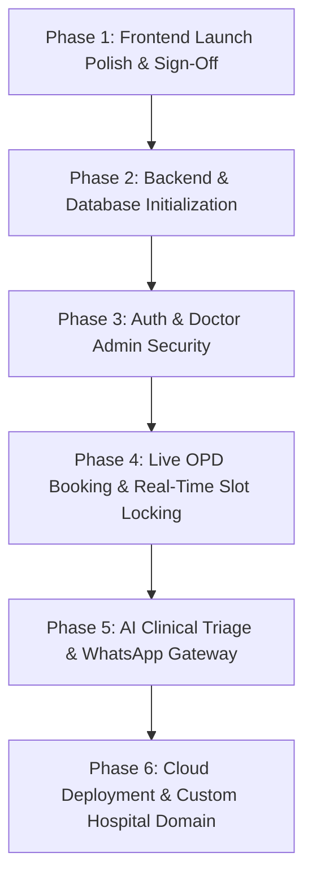

# 🗺️ Master Implementation Plan — Mission Gastrocare

**Phased Execution & Delivery Roadmap**  
*Document Version: 1.0.0*

---

## 1. Project Phase Breakdown

---

## Phase 1: Frontend Launch Polish & Doctor Review (Current Phase)

### Objectives
Complete the remaining minor frontend items, verify all 18 production readiness checklist items, and complete executive review with Dr. Jitendra Mistry.

- [x] Categorized Photo Gallery with 27 scraped photos (`src/pages/Media.tsx`).
- [x] Medical Discretion Sensitive Photo Blur Shield (Gaussian blur + one-tap reveal).
- [x] Live search filter for Campus Gallery (`#enteroscopy`, `#ICU`, `#OT`).
- [x] SPA client-side routing fixes (React Router `<Link>` everywhere, zero hard reload 404s).
- [x] Render SPA rewrite rules (`public/_redirects`, `public/static.json`, `render.yaml`, `public/404.html`).
- [x] Redesigned Executive 404 Error Screen (`src/pages/NotFound.tsx`).
- [x] Privacy Policy (`/privacy-policy`) & Terms (`/terms-and-conditions`).
- [x] Search Engine Crawling (`public/sitemap.xml`, `public/robots.txt`).
- [x] Honeypot anti-spam protection in `AppointmentForm.tsx` and `Contact.tsx`.
- [x] Google Analytics 4 (GA4) script tag in `index.html`.
- [x] Route-level Code Splitting across 14 routes with `React.lazy()` and `<Suspense>`.
- [x] Class-based `RouteErrorBoundary` preventing blank-screen crashes on network drops.
- [x] WCAG Keyboard Accessibility on Doctor Flip Cards (`role="button"`, `tabIndex={0}`, Enter/Space).
- [x] CodeRabbit Static Analysis Audit completed (all 15 genuine architectural & security gems adapted).
- [x] Configured `.coderabbit.yaml` path filters to isolate project application code from third-party tool assets.
- [ ] Replace `G-MGCGA4TAG` in `index.html` with Dr. Mistry's live GA4 ID when provided.
- [ ] Add toast notification popups upon OPD Booking and Contact submission.
- [ ] Convert facility JPEG images to `.webp` format for sub-second mobile page loads.

---

## Phase 2: Backend Workspace & PostgreSQL Database Setup

### Objectives
Initialize the server workspace, connect PostgreSQL, and define Prisma ORM schema models.

1. **Server Initialization**:
   - Create `server/` directory.
   - Install dependencies: `express`, `cors`, `dotenv`, `jsonwebtoken`, `bcryptjs`, `@prisma/client`, `zod`.
   - Setup TypeScript configuration (`tsconfig.json`).
2. **Database Provisioning**:
   - Provision PostgreSQL database on **Render / Neon / Supabase**.
   - Configure connection string in `server/.env`.
3. **Prisma ORM Setup**:
   - Implement schema models from `docs/database.md`.
   - Run `npx prisma db push` to generate database tables.

---

## Phase 3: Authentication & Doctor Admin Security

### Objectives
Implement secure authentication for Dr. Mistry and staff to manage appointments and health advisories.

1. **Password Hashing**: Bcrypt with 12 salt rounds (strictly enforce 72-byte max password length in Zod).
2. **Session Security**: JWT generated on login and stored in `HttpOnly`, `SameSite=Strict`, `Secure` cookies (with `SameSite=None` fallback for cross-domain staging).
3. **RBAC Middleware**: Restrict `/api/v1/admin/*` to `SUPER_ADMIN`, `DOCTOR`, and `RECEPTIONIST` roles based on least-privilege scope.
4. **Login Endpoint**: Implement `POST /api/v1/auth/login` and `POST /api/v1/auth/logout`.

---

## Phase 4: Live OPD Appointment & Real-Time Slot Locking

### Objectives
Connect the patient appointment form to the live database and prevent double-booking.

1. **Slot Conflict Locking & Cancellation Reopening**:
   - Database partial unique index on `[doctorId, opdDate, slotTime]` WHERE `status != 'CANCELLED'`.
   - Reopens slot automatically if cancelled; rejects active conflicting requests with `409 Conflict`.
2. **Booking API**:
   - Implement `POST /api/v1/appointments/book`.
   - Honeypot anti-spam bot check.
3. **Doctor Queue Dashboard**:
   - Implement `GET /api/v1/admin/appointments` with status filtering (`PENDING`, `CONFIRMED`, `COMPLETED`, `CANCELLED`).
   - Scope queries: `DOCTOR` sees only their assigned queue; `SUPER_ADMIN`/`RECEPTIONIST` see hospital-wide queue.
   - Official printed payment receipt generation.

---

## Phase 5: AI Clinical Triage & WhatsApp Notification Gateway

### Objectives
Automate patient symptom evaluation and mobile ticket confirmations.

1. **Google Gemini 1.5 Flash API**:
   - Secure backend proxy endpoint `POST /api/v1/ai/triage`.
   - Server-side rate limiter (5 calls per 10 mins).
   - Medical disclaimer enforcement.
2. **WhatsApp / SMS Gateway**:
   - Integrate Twilio or Interakt WhatsApp API.
   - Send automatic booking confirmation with booking reference `MGC-XXXXXX` and hospital address on WhatsApp.

---

## Phase 6: Cloud Deployment & Custom Domain Cutover

### Objectives
Deploy the full-stack system and bind the hospital's official domain.

1. **Deploy API on Render**:
   - Create Render Web Service connected to `server/`.
   - Configure environment variables and CORS headers.
2. **Frontend Production Build**:
   - Point API baseUrl to production URL.
   - Verify zero TypeScript or Vite build errors.
3. **DNS & Custom Domain**:
   - Point custom hospital domain (e.g., `missiongastrocare.com`) to Render.
   - Verify SSL certificates.

